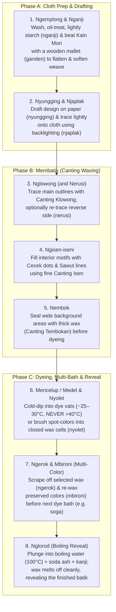

# Canting & Batik Tulis — Deep Craft, Culture & Mechanics Reference

> **Purpose:** Comprehensive reference on traditional Indonesian *batik tulis* and *canting* craftsmanship—covering wax chemistry, workshop ergonomics, tool taxonomy, natural dye alchemy, regional motif traditions, cultural etiquette, and community division of labor—mapped directly to **Canting Cloth's** core mechanics and GIMERSIA themes (*Melestarikan*, *Gotong Royong*, *Pulang*).

---

## 1. Physical Ground Rules of *Canting* & Handling Mistakes

In traditional *batik tulis*, molten wax (*malam*) is drawn onto natural cloth (*kain mori* cotton or silk). Because hot wax immediately **penetrates the weave fibers**, it obeys strict physical rules that differ completely from ink or digital brushes:

### Core Physical Rules
1. **Hot Wax Is Not Instantly Erasable:**
   If molten wax drips where it shouldn't (*ketetesan malam* / *mbleber*), wiping it while still liquid smears the wax wider and pushes it deeper into the fibers. An artisan must let the wax **cool and solidify** before attempting any correction.
2. **Blowing the Spout (*Niup Cucuk*):**
   After scooping hot wax from the pan, the artisan gently blows on the spout tip (*cucuk*)—or brushes it lightly on their lap cloth (*taplak*)—before touching the fabric. This clears cooled wax film and prevents a heavy blob at the start of a line.
3. **Closed Boundaries & Double-Sided Penetration (*Nerusi*):**
   Wax is a **resist shield**, not paint. In the dye bath, any break in an outline (*garis terputus*) lets dye seep inside, and wax applied too cold or too fast sits only on the surface (*malam tidak meresap*). For fine batik, artisans flip the cloth and re-trace main outlines on the reverse (*nerusi*) so the resist seals completely through the fabric.
4. **Temperature, Speed & Crackle (*Remekan*):**
   - **Too hot:** Wax turns watery and bleeds uncontrollably (*nembus berlebih*).
   - **Too cold / moving too fast:** Wax cools in the spout, clogging or skipping lines.
   - **Bending cooled wax:** Brittle or flexed wax develops hairline cracks (*remekan*), allowing thin dye veins to seep in. (Intentional in some coastal styles; a structural leak in crisp protective barriers.)

### How Real *Pembatik* Handle Mistakes → *Canting Cloth* Design Rule
Real artisans combine three practices that integrate cleanly with your **Magic Capacity Gauge** and **Global Time Economy**:

| Traditional Practice | Real-World Craft Behavior | Gameplay Rule in *Canting Cloth* |
| :--- | :--- | :--- |
| **1. *Njaplak* (Pencil Drafting First)** | Artisans trace or sketch the framework onto cloth in pencil/charcoal before touching hot wax; pencil washes out during dyeing/boiling. | **Free Planning Layer:** Optional guide sketch on the panel. Costs **0 Magic Capacity** and **0 Time**; freely erasable. |
| **2. *Improvisasi Isen-isen* (Creative Adaptation)** | A stray wax drop or wobbly line is rarely treated as failure—artisans turn it into filler dots (*cecek*), leaves, or tendrils inside the motif. | **Both Contribute to Gauge:** Because both *Klowong* outlines and *Cecek/Isen* details fill the garment's **Magic Capacity Gauge**, small slips can naturally become part of your design. |
| **3. *Nge-jos / Kasakan* (Hot Iron Extraction)** | Let the unwanted drop cool, dampen the surrounding cloth to prevent scorching, press a heated iron tip (*besi nge-jos*) onto the wax to remelt it, and blot immediately from **both front and back** with scrap cloth (*kain perca*). Faint residue often stays in the fibers. | **Targeted Wax Removal:** Removes an unwanted stroke to reclaim **Magic Capacity**, at a **Global Time cost** (or leaving a tiny permanent residue mark in the gauge)—honoring real wax permanence without forcing full restarts. |

---

## 2. Wax (*Malam*) Chemistry & Blends

Batik *malam* is never a single pure wax; it is a carefully balanced blend of natural resins, waxes, and petroleum derivatives formulated to control **melting point, viscosity, adhesion, crackle, and ease of boiling off**:

### Core Ingredients
- ***Gondorukem* (Pine Rosin):** Distilled resin from *Pinus merkusii*. Gives clarity, strengthens line structure, helps wax freeze quickly on cloth, and improves adhesion. (Too much makes wax brittle.)
- ***Lilin Lebah* / *Kote* / *Malam Tawon* (Beeswax):** Natural honeybee wax. Provides strong fiber adhesion so lines do not flake off during handling and dyeing.
- **Paraffin:** White petroleum wax. Controls hardness, promotes intentional crackle if used heavily, and makes wax easy to melt off during *nglorod*.
- ***Microwax* (Microcrystalline Wax):** Elastic synthetic petroleum wax. Adds flexibility so wax won't crack unintentionally, controls excess bleed-through, and resists alkaline dye baths.
- **Additional Modifiers:** *Damar mata kucing* (sharpens line edges and boosts alkali resistance) and small amounts of animal/vegetable fat (*kendal*) or coconut oil to adjust flow viscosity.

### Thermal Rules & The 3 Functional Wax Blends
Batik wax generally softens around **40°C–50°C** and melts around **55°C–70°C** (typically averaging **59°C–68°C** depending on the recipe):

| Wax Blend | Primary Craft Use | Physical Properties |
| :--- | :--- | :--- |
| ***Malam Klowong*** | Main outlines (*nglowongi*), *isen-isen*, and reverse-tracing (*nerusi*). | Flows easily when heated, freezes fast into sharp lines, lower alkali resistance, washes off cleanly in *nglorod*. |
| ***Malam Tembokan*** | Blocking large background zones (*nembok*) to keep them completely dye-free. | Higher melting stability, **very strong fiber grip**, **alkali-resistant** (survives repeated dips), harder to boil off. |
| ***Malam Biron* (Tutupan)** | Sealing colored areas (*mbironi*) after the first dye bath before dipping into a second color. | Similar flow and clean *lorod* release as *malam klowong*, formulated (often with recycled wax, paraffin, *kote*, and *gondorukem*) not to stain existing dye underneath. |

---

## 3. Workshop Setup, Ergonomics & Holding the *Canting*

Knowing the physical tools of a real batik station informs both your 3D workshop visuals (`bp_worktable` / workshop environment) and UI feel:

### Traditional Workstation Gear
- ***Gawangan*:** A wooden or bamboo rack that drapes and holds the *kain mori* suspended at working height so the artisan can move smoothly across the cloth without pressing wax against a hard surface.
- ***Dingklik*:** A low wooden stool where the artisan sits stably for hours of calm, focused work.
- ***Anglo* & *Wajan*:** A small clay or metal charcoal brazier (*anglo*) supporting a shallow metal/copper pan (*wajan*) that keeps *malam* molten at steady heat.
- ***Bandul*:** Small weights (stone, wood, or lead in cloth pouches) clipped to the bottom edges of the fabric to keep it taut and prevent wind or hand movement from shifting the cloth.
- ***Taplak*:** A protective cloth draped over the artisan's thighs to catch hot wax drips and wipe excess wax from the *canting* spout.

### Technique & Angle
- The *canting* is held in the dominant hand much like a pen (thumb and index finger guiding the *gagang* handle, middle/lower fingers supporting underneath).
- It is tilted at roughly a **45° angle** to the fabric surface—steep enough that molten wax doesn't spill backward out of the *nyamplung* bowl, yet angled so the curved *cucuk* spout feeds a steady, unbroken bead onto the cloth without dragging or dripping.

---

## 4. Anatomy & Full Taxonomy of *Canting* Tools

Every *canting* has three parts:
- ***Nyamplung*:** Thin copper bowl/reservoir (copper conducts and holds heat evenly).
- ***Cucuk* (or *Carat*):** Tiny curved copper spout acting like a fountain-pen nib.
- ***Gagang*:** Lightweight bamboo or wood handle.

### A. By Function (Core Tool Set)
1. ***Canting Reng-rengan / Klowong*:** Medium single spout for primary motif outlines (*klowongan*).
2. ***Canting Isen-isen / Cecek*:** Ultra-fine spout for inner dots (*cecek*) and fine lines (*sawut*, *ukel*).
3. ***Canting Tembokan*:** Wide, thick spout for rapidly blocking out solid wax walls (*nembok*).

### B. By Spout Count & Arrangement (*Gotong Royong* Unlocks)
Artisans use multi-spout *canting* to stamp repeating geometric textures in a single gesture—ideal gifts or learned techniques exchanged through community cooperation (*Gotong Royong*):

| Tool | Spout (*Cucuk*) Layout | Craft Purpose |
| :--- | :--- | :--- |
| ***Canting Cecekan*** | 1 fine spout | Single dots (*nyeceki*) and delicate spirals (*ukel*). |
| ***Canting Loron*** | 2 parallel spouts (*loro* = two) | Double parallel lines / border bands in one stroke. |
| ***Canting Telon*** | 3 spouts in an equilateral triangle (*telu* = three) | Stamps crisp 3-dot triangular *cecek* clusters. |
| ***Canting Prapatan*** | 4 spouts in a square | Stamps 4-dot square grid textures. |
| ***Canting Liman*** | 5 spouts (square + center) | Stamps 5-dot quincunx flower/star clusters. |
| ***Canting Byok*** | Odd count (7+ spouts in a ring + center) | Stamps full circular dot rosettes with one touch. |
| ***Canting Renteng / Galaran*** | Even count (4–6+ spouts in a straight row) | Draws multiple evenly spaced parallel hatching lines at once (*galar* = slatted bamboo bed). |

---

## 5. The Complete 8-Stage Traditional Pipeline & Chemistry

### Critical Thermal & Chemical Contrast
- **Cold Dyeing (Always Below ~40°C):** Because *malam* softens at `40°C–50°C`, traditional dye baths (*Naptol*, *Indigosol*, *Remazol*, and fermented *Indigofera* vats) are performed at **room temperature (`25°C–30°C`)**. Warm dye melts the wax and ruins the resist!
- **Boiling *Nglorod* (`100°C`):** Only at the very end is the cloth plunged into **boiling water (`100°C`)** mixed with:
  - ***Soda Ash* (Sodium Carbonate):** Weak alkali that speeds up breaking the wax's grip on cotton fibers (also used in reactive dyeing to raise pH so dye binds to fibers).
  - ***Tepung Kanji* (Tapioca Starch):** Added to the boiling vat to **bind loose melted wax droplets** so they float away rather than re-sticking to clean cloth.
  - *(For synthetic reactive dyes like Remazol, **Waterglass / Sodium Silicate** is brushed or dipped beforehand as a cold color-locking agent before nglorod.)*

---

## 6. Natural Dye Alchemy (*Pewarnaan Alam*), Fixatives & Oxidation

Traditional Indonesian dyes come from tree barks, roots, and fermented leaves—offering rich material lore and progression for your **Dye & Reveal** stage:

### Classical Botanical Dyes
| Plant Source | Part Used | Color Produced | Traditional Context |
| :--- | :--- | :--- | :--- |
| ***Indigofera tinctoria* (*Tom / Nila*)** | Fermented leaves (indigo paste) | Classic deep **Indigo Blue** (*wedel / medel*) | Base blue across both Keraton and coastal batik. |
| ***Soga Tingi* (*Ceriops tagal*)** | Mangrove tree bark | Rich **Reddish-Brown / Deep Brown** | Core ingredient of Solo/Yogyakarta *sogan* brown. |
| ***Tegeran* (*Cudrania / Maclura cochinchinensis*)** | Heartwood shavings | Bright **Golden Yellow** | Blended with *tingi* and *jambal* to balance warm *sogan*. |
| ***Soga Jambal* (*Peltophorum pterocarpum*)** | Tree bark | Dark earthy **Soga Brown** | Deepens *sogan* tone alongside *tingi* and *tegeran*. |
| ***Mengkudu* (*Morinda citrifolia*)** | Root bark | Deep **Red / Maroon** (*bang-bangan*) | Famous historic red of coastal Lasem batik. |

### The Magic of Indigo Oxidation (*Medel*)
Natural indigo dyeing has a striking visual transformation built into real chemistry:
1. **Reduction in the Vat:** Indigo paste is water-insoluble, so it is fermented with natural reducing agents (palm sugar/molasses + lime/alkali) until it dissolves into pale **greenish-yellow *leuco-indigo***.
2. **Drying & Air Oxidation:** When cloth is pulled from the vat, it emerges **pale green/yellow**. As oxygen hits the wet fibers in the open air, the cloth visibly transforms before your eyes into **deep indigo blue**!
3. **Repeated Dips:** Achieving deep midnight navy takes multiple cycles of dipping and air-oxidizing—never a single instant dunk.

### The 3 Traditional Fixatives (*Fiksasi*)
After dipping in botanical extracts (especially *soga* tannins), a single dip can yield **three completely different shades** depending on which mineral fixative locks the color:
- ***Tawas* (Alum):** Produces **brighter, lighter, clearer** tones.
- ***Kapur* (Slaked Lime / Calcium Hydroxide):** Shifts toward **warmer, richer, slightly reddish/mature** tones.
- ***Tunjung* (Ferrous Sulfate / Iron):** Reacts strongly with plant tannins to turn colors **dramatically darker, deep earthy, or blackish (*medok*)**.

---

## 7. *Kain Mori* Fabric Grades → The Magic Capacity Gauge

Thread density and weave tightness govern how crisp wax lines stay (*daya serap malam*). This aligns naturally with **fabric properties and each garment's Magic Capacity Gauge**:

| Fabric Type | Thread Density & Construction | Real Wax Behavior | *Canting Cloth* Stat Mapping |
| :--- | :--- | :--- | :--- |
| ***Kain Mori Biru*** | Coarser cotton (`Ne 28–36`), looser weave. | Wax spreads wider; less suited for dense tiny *cecek* details. | **Low Magic Capacity Limit**, sturdy durability, favors bold simple *klowong* strokes. |
| ***Kain Mori Prima*** | Standard mid-grade cotton (`Ne 36–46`). | Balanced wax absorption and edge crispness. | **Medium Magic Capacity Limit**, balanced weight and durability (strong starter fabric). |
| ***Kain Mori Primisima*** | Highest-grade cotton (`Ne 50–56`, ~105–125 warp × 100–120 weft/inch). | Ultra-smooth, tight weave; holds razor-sharp *klowong* and packed *cecek* dots without bleeding. | **High Magic Capacity Limit**, allows dense inscriptions on compact panels. |
| ***Kain Sutera* (Silk)** | Fine natural silk; fluid drape. | Rich dye luster; slick surface requires careful wax locking so wax doesn't flake (*ngelotok*). | **High Magic Capacity + Very Low Weight**, lower abrasion resistance. |

---

## 8. Motif Taxonomy, Regional Styles & Cultural Etiquette (*Melestarikan*)

### 1. The Two Great Regional Styles
- ***Batik Pedalaman / Vorstenlanden* (Inland Royal Courts — Surakarta & Yogyakarta):**
  Strict *pakem* (traditional rules), deep philosophical symbolism, and an earthy restrained palette of **Soga brown, Indigo blue, black, and cream/white**.
- ***Batik Pesisiran* (North Coast & Madura — Pekalongan, Cirebon, Lasem, Indramayu, Madura):**
  Freer, dynamic compositions shaped by Chinese, Indian, Arab, and European maritime exchange, featuring vibrant colors and expressive brushwork (*nyolet*).

### 2. Key Classical & Regional Motifs (Cultural Accuracy Reference)
| Motif | Region / Style | Visual Form | Authentic Cultural Meaning & Rules |
| :--- | :--- | :--- | :--- |
| ***Parang*** | *Vorstenlanden* | Continuous diagonal S-waves (resembling ocean waves striking rock / slopes *pereng* / blade). | Relentless effort, courage, moral fortitude. **Royal *Batik Larangan* (*Awisan Dalem*). Taboo at weddings** because it symbolizes struggle/waves rather than peaceful harmony. |
| ***Kawung*** | *Vorstenlanden* | Four-lobed oval geometry arranged symmetrically (like *kolang-kaling* palm fruit). | Ancient motif of justice, self-control, purity of heart, and remembering one's origins. Historically part of *Batik Larangan*. |
| ***Semen*** | *Vorstenlanden* | Sprouting vines (*semi* = sprout), sacred mountain (*meru*), birds/wings (*sawat/lar*). | Cosmic fertility, growth, and wise, grounded leadership (*Semen Rromo / Semen Gede*). |
| ***Nitik*** | *Vorstenlanden* | Fine geometric clusters of square/short dashed dots mimicking woven Indian *Patola* silk. | Classical elegance, patience, and order. |
| ***Sido Mukti* & *Wahyu Tumurun*** | *Vorstenlanden* | Symmetrical diamond grids enclosing auspicious symbols of prosperity & blessing. | **Preferred wedding motifs** (*Sido Mukti* = lasting prosperity & happiness; *Wahyu Tumurun* = divine grace & guidance). |
| ***Truntum*** | *Vorstenlanden* | Star-like tiny blossoms scattered on dark cloth. | Enduring, rekindled love (*tumaruntum* = growing anew); created by Kanjeng Ratu Kencana, traditionally worn by bride/groom parents as symbols of steady guidance. |
| ***Gringsing*** | Traditional / Classical | Interlocking circular/fish-scale mesh with center eyes. | From *gering* (sick) + *sing* (not/warded off): **protection from illness, misfortune, and imbalance**. |
| ***Tambal*** | Traditional / Classical | Patchwork of varied motif triangles/squares stitched visually on one cloth. | Symbolizes **mending and recovery**; historically draped over the ill to "patch" health and wholeness. |
| ***Slobog*** | *Vorstenlanden* | Diagonal-quartered geometric squares with small center rosettes (*lobok* = loose/open). | **Solemn mourning motif** worn at funerals to pray for the departed's unhindered passage and strength for those left behind. Treat with cultural gravity. |
| ***Mega Mendung*** | *Pesisiran* (Cirebon) | Layered swirling clouds with 7-step tonal gradations. | Chinese-Cirebon acculturation symbolizing patience, cooling calm in anger, and life-giving rain. |
| ***Batik Tiga Negeri*** | Cross-Regional Masterwork | Combines royal court & Chinese-coastal motifs across 3 distinct dye traditions. | Historically dyed across **three cities** for perfection: red in **Lasem**, blue in **Pekalongan/Kudus**, and brown *soga* in **Solo/Yogyakarta**. |
| ***Batik Gentongan*** | *Pesisiran* (Madura) | Bold, high-contrast coastal flora/fauna and expressive strokes. | Soaked long-term inside giant clay jars (*gentong*) with natural dyes for vivid, unmistakable colors. |

### 3. Ethical Representation (UNESCO & GDD Pillar P4)
- On **October 2, 2009**, **UNESCO** recognized *Batik Indonesia* as *Masterpieces of the Oral and Intangible Heritage of Humanity*—honoring not only *canting* wax-resist technique, but also the **philosophical meanings, life-cycle rituals, and *pakem* etiquette** woven into the cloth.
- **Design Rule:** Keep real cultural meanings accurate in dialogue, codex notes, and motif stories, while clearly framing *Canting Cloth's* expedition stats and spell wards as your **fantasy workshop's magical interpretation of wax geometry and craft skill**.

---

## 9. Community Division of Labor (*Gotong Royong* in Real Batik Villages)

In historic Indonesian batik centers—such as **Kampung Batik Giriloyo** (Yogyakarta), **Kampung Batik Laweyan** (Solo, historically organized by merchant-matriarchs *Mbok Masé*), and **Trusmi** (Cirebon)—a single fine cloth is rarely completed by one pair of hands alone. Communities practice structured specialization and mutual help (*paguyuban* / *gotong royong*):

| Traditional Specialist | Responsibility in the Village Workshop | Mechanical Inspiration for *Gotong Royong* in *Canting Cloth* |
| :--- | :--- | :--- |
| ***Tukang Nyungging / Nyorek*** | Designs paper patterns and transfers outlines (*njaplak*) onto cloth. | Sharing or co-creating **layout templates / sketch guides** (*Njaplak*) that save planning effort. |
| ***Tukang Klowong*** | Draws primary outlines (*klowongan*) with *Canting Klowong*. | **Apprentice/Artisan Aid:** Assisting with base outline prep or teaching cleaner structural connections. |
| ***Tukang Isen*** | Patiently fills interiors with *cecek*, *sawut*, and *gringsing*. | Lending **multi-spout *canting*** (*Loron, Telon, Byok*) so you can apply dense *isen* faster at lower Global Time cost! |
| ***Tukang Tembok*** | Blocks large areas with heavy *malam tembokan*. | Unlocking **blocking techniques / heavy wax blends** for Guardian-tier protection. |
| ***Tukang Mbabar / Medel / Soga*** | Manages shared fermented indigo and *soga* dye vats and multi-dip oxidation. | **Shared Village Dye Vats & Fixatives:** Access to community *Soga*, *Indigo*, or *Tunjung/Tawas* fixatives—or paying Global Time vs. community favor for communal vat dyeing (*Tiga Negeri*-style collaboration). |
| ***Tukang Lorod*** | Runs the boiling *nglorod* vats and rinses finished cloth cleanly. | **Time Economy Synergy:** Community helpers reducing *lorod* / assembly turnaround time when you support the village's travelers. |
